<div align="center">

# OrgSpace · CSPC Student Organizations Website

**A multi-page website for the student organizations of Camarines Sur Polytechnic Colleges (CSPC), built with plain HTML and CSS.**


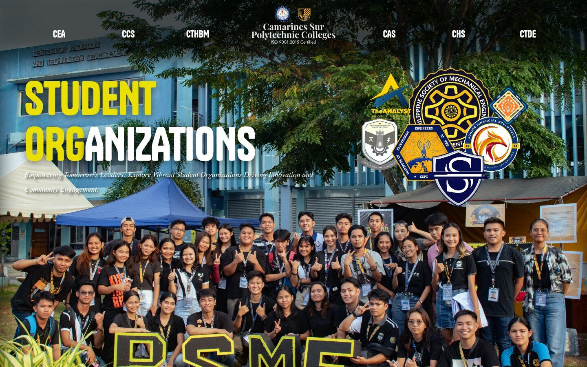

</div>

---

## Table of Contents

- [About the Project](#about-the-project)
- [Project Details](#project-details)
- [Screenshots](#screenshots)
- [Results](#results)
- [Design Choices](#design-choices)
- [Project Structure](#project-structure)
- [Running It Locally](#running-it-locally)
- [Known Issues and Lessons Learned](#known-issues-and-lessons-learned)
- [Credits](#credits)

---

## About the Project

This website is the final project for **CCCS 101 (Introduction to Computing)**, taken by first-year BS Computer Science students in the College of Computer Studies at CSPC. The project brief was open-ended: build a webpage using only HTML and CSS, such as a personal portfolio, a travel blog, a survey form or a tribute page.

Instead of a portfolio, the student chose to build something for the school itself. CSPC has many student organizations spread across its colleges, but they had no single place where a new student could find them. The result is a landing page that shows every college, plus a page for each college that lists its organizations, what they do, and how to reach them.

The idea behind the site is simple. A student who is curious about joining an organization should be able to open one page, pick their college, and read about their options in under a minute.

## Project Details

| | |
|---|---|
| **Project type** | Final project |
| **Course** | CCCS 101, Introduction to Computing (BSCS 1) |
| **School** | College of Computer Studies, Camarines Sur Polytechnic Colleges, Nabua, Camarines Sur |
| **Term** | 1st Semester, S.Y. 2023-2024 (final examination period: December 10 to 16, 2023) |
| **Date of development** | November 30 to December 11, 2023 |
| **Technologies** | HTML5, CSS3 (no JavaScript frameworks, no libraries) |
| **Fonts** | Tanker, General Sans, Bespoke Serif (Fontshare); Jost, Playfair Display (Google Fonts) |

> The development dates come from the file timestamps in the project. The earliest photo asset was saved on November 30, 2023 and the last page edit was on December 11, 2023.

## Screenshots

Full-page captures were taken at a 1440 px wide desktop viewport. Click an image to open the full-length page.

### Landing page

[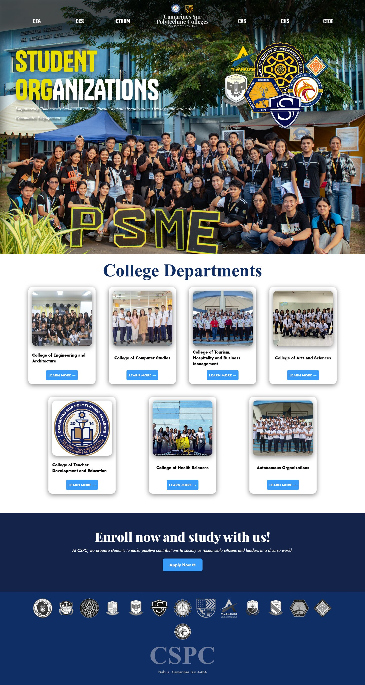](screenshots/index.jpg)

The landing page opens with a full-width hero photo, a bold two-tone title, and the logos of the organizations floating over the picture. Below it are seven cards, one for each college plus one for the autonomous (institution-wide) organizations. Each card has a photo, the college name and a **Learn more** button.

### College and organization pages

| College of Engineering and Architecture | College of Computer Studies |
|:---:|:---:|
| [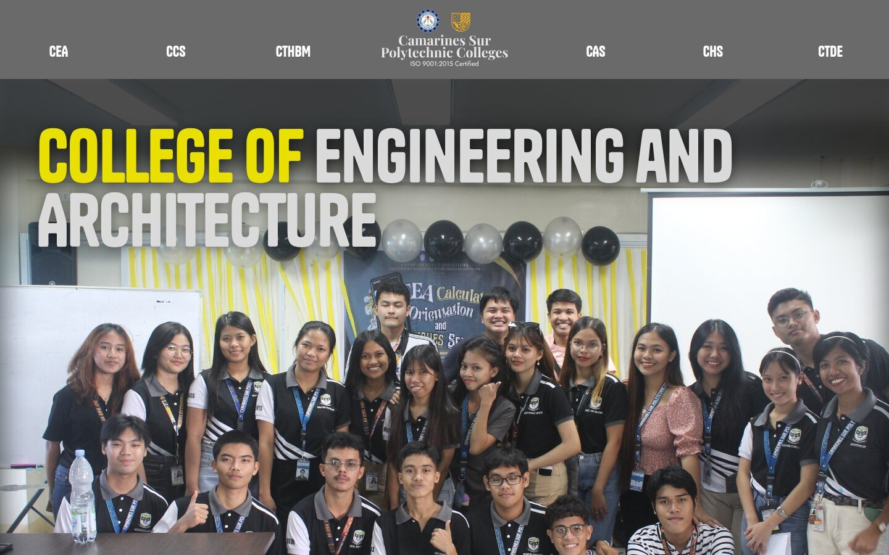](screenshots/cea.jpg) | [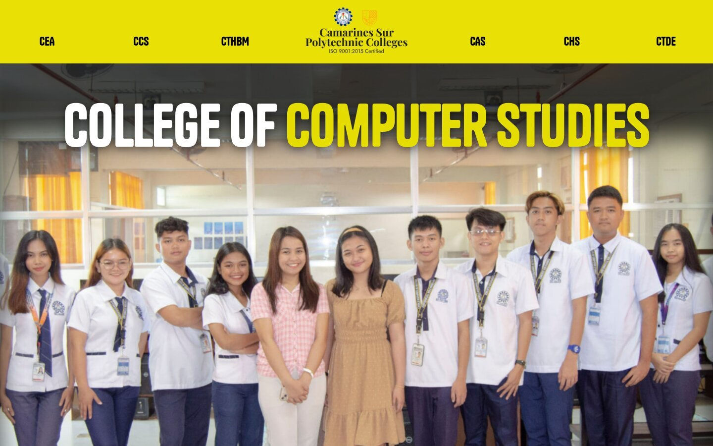](screenshots/ccs.jpg) |
| **College of Tourism, Hospitality and Business Management** | **College of Arts and Sciences** |
| [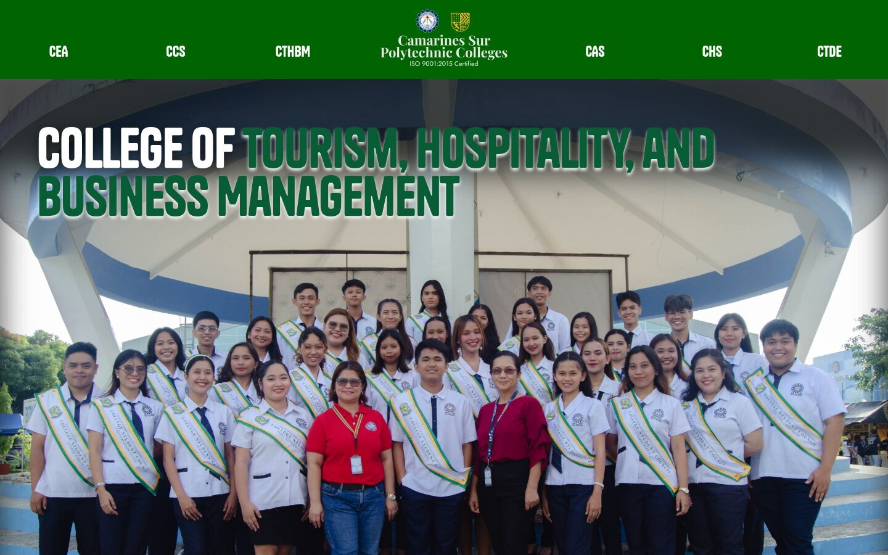](screenshots/cthbm.jpg) | [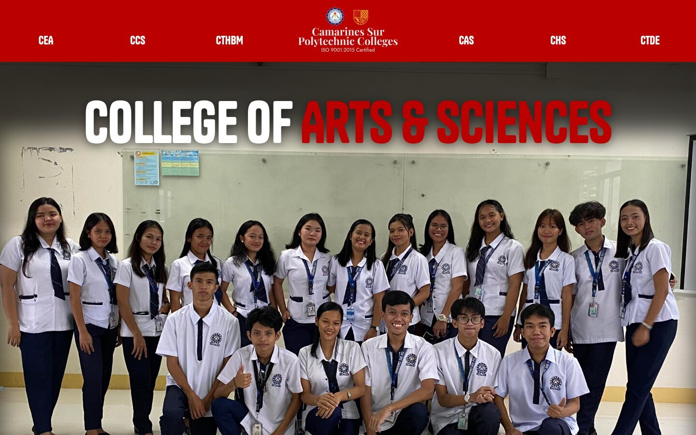](screenshots/cas.jpg) |
| **College of Health Sciences** | **Autonomous Organizations** |
| [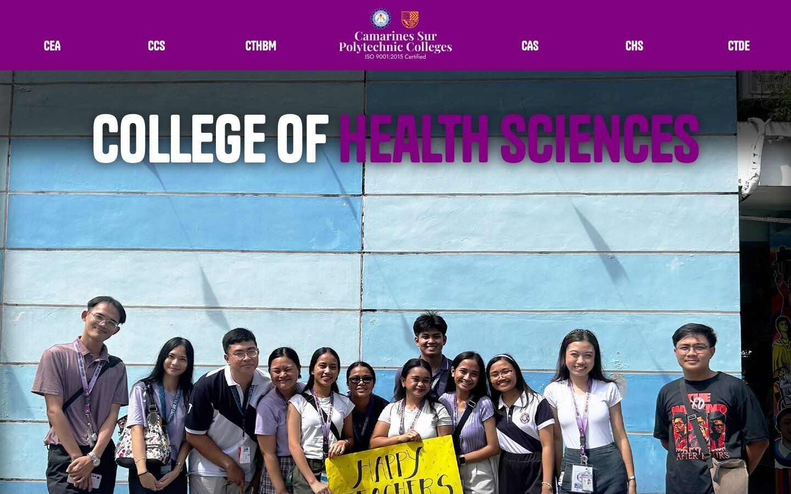](screenshots/chs.jpg) | [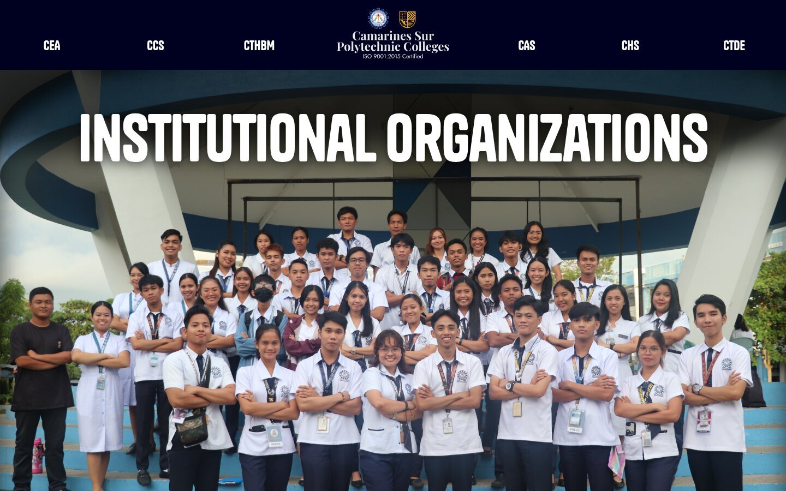](screenshots/institutional.jpg) |

### Page layout in full

Each college page follows the same pattern: hero banner with the college name, then the organization profiles (logo on one side, description and contact icons on the other, alternating left and right), then the enrollment banner and the footer.

[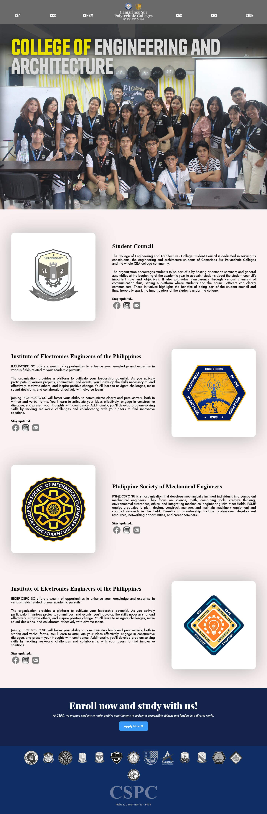](screenshots/cea.jpg)
[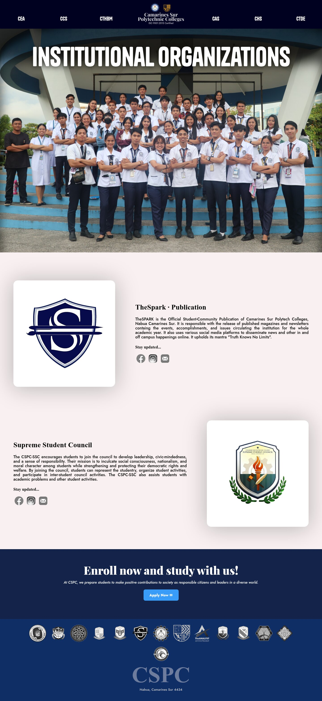](screenshots/institutional.jpg)

### Coming soon page

The College of Technological and Developmental Education page is a placeholder. Its organization profiles were not added, so the page keeps the same header, banner and footer and shows a "coming soon" message.

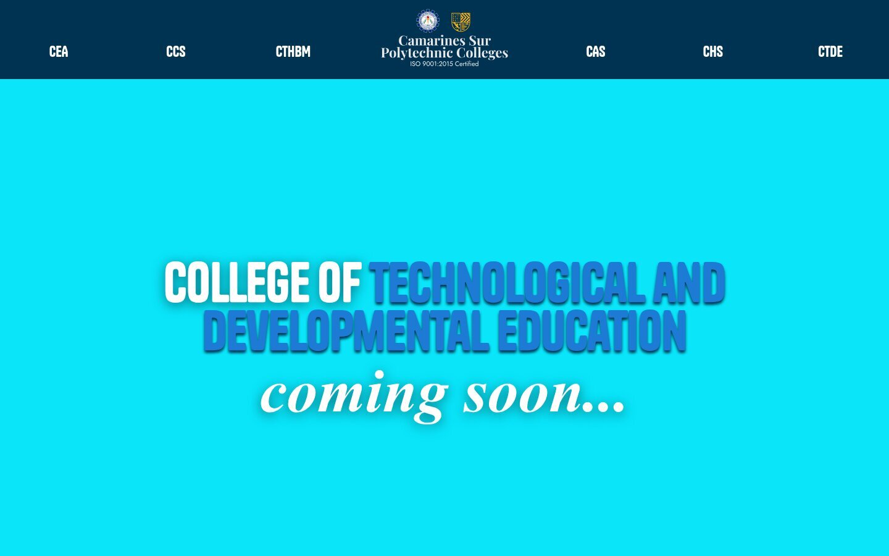

## Results

The project was finished within the final exam week. This is what ended up in the final version:

| Deliverable | Result |
|---|---|
| Pages | **8** (1 landing page, 6 college pages, 1 institutional page) |
| Organization profiles | **12** profile blocks across 6 pages, each with a logo, a description and contact links |
| Logos and graphics | **14** school and organization logos, plus custom-made navigation, footer and landing graphics |
| Stylesheets | **10** CSS files, about 2,400 lines in total |
| Navigation | Every page has the same top bar with all six colleges and a logo that returns to the home page, so no page is a dead end |
| Calls to action | An "Apply Now" button on every page that links to the CSPC enrollment portal |

### How it measures up against the project rubric

The course rubric graded five things. Here is how the site answers each one.

| Criteria | What the site does |
|---|---|
| **Layout and design** | A consistent look across all pages: dark navy and bright blue as the main colors, a full-width hero on each page, card layout on the landing page and alternating text and logo rows on the college pages. Text sits in readable columns with plenty of spacing. |
| **Graphics** | Real photos of the organizations are used as banners, and the logos are shown in white tiles so they stay clear against any background. The footer repeats every logo in a single row. |
| **Information** | Each organization gets a short description of who they are and why a student might join. Contact icons (Facebook, Instagram, email) sit under each description. |
| **Navigation and links** | A shared top bar, image-based links (the logo and the social icons), cards with "Learn more" buttons and a persistent "Apply Now" button. |
| **Creativity** | The logo cluster over the landing page hero, the two-tone title where only part of the word is highlighted, the hover effect on the nav buttons (the text grows and spreads out) and a fade-in transition when most pages load. |

The final score for the project is not recorded here.

## Design Choices

- **Plain HTML and CSS only.** This matches the project requirement and meant every layout decision had to be done by hand with flexbox, absolute positioning and background images.
- **Two font families doing different jobs.** Tanker is the loud display font for titles and the nav, Playfair Display gives headings a more formal feel, and Jost keeps the body text easy to read.
- **One stylesheet per page.** Each page has its own CSS file so changes on one college page could not break another. The trade-off is that a lot of code is repeated between files (see below).
- **Photos as banners.** Using the organizations' own group photos as the hero image makes the site feel like it belongs to the students, not like a template.
- **Darkened top edge.** The hero images have a dark shadow across the top so the white navigation text stays readable on any photo.

## Project Structure

```
cspc-orgspace/
├── index.html            Landing page
├── INSTITUTIONAL.html    Autonomous organizations (TheSpark, Supreme Student Council)
├── CEA.html              College of Engineering and Architecture
├── CCS.html              College of Computer Studies
├── CTHBM.html            College of Tourism, Hospitality and Business Management
├── CAS.html              College of Arts and Sciences
├── CHS.html              College of Health Sciences
├── CTDE.html             Technological and Developmental Education (coming soon)
├── css/                  One stylesheet per page, plus shared style.css and animations.css
├── logo/                 College and organization logos
├── made/                 Navigation, footer and landing graphics made for the site
├── icons/                Facebook, Instagram and email icons (SVG)
├── screenshots/          Images used in this README
└── fonts.txt             Notes on the web fonts used
```

## Running It Locally

The pages load their assets with root-absolute paths such as `/css/index.css`, so opening the HTML files by double-clicking will show unstyled pages. Serve the folder as the site root instead:

```bash
git clone <repository-url>
cd cspc-orgspace
python3 -m http.server 8000
```

Then open <http://localhost:8000/> in a browser. An internet connection is needed for the web fonts.

> **About the missing photos:** the banner and card photos live in a `/photo/` folder that is about 53 MB, so it is not included in this repository. Without it the pages still work, but the hero banners and card pictures will be blank. The screenshots above were taken with the full photo folder in place.

## Known Issues and Lessons Learned

Looking back at the project, a few things could be better:

- **Desktop only.** The layout uses fixed widths (for example a 1320 px wide container) and has no media queries, so it does not adapt to phones or small tablets.
- **A wrong link.** On the landing page, the card for the College of Teacher Development and Education links to `CTHBM.html` instead of `CTDE.html`.
- **Repeated content on the CEA page.** The fourth profile on the College of Engineering and Architecture page reuses the IECEP description text under a different logo. It was meant to be a separate organization.
- **Empty social links.** Several Instagram icons have no destination yet, and a few contact links point to the wrong account.
- **Copy-pasted CSS.** The college stylesheets are nearly identical, around 290 lines each. One shared stylesheet with small per-page overrides would be much easier to maintain.
- **Large photos.** Some of the original photos are more than 10 MB. Resizing and compressing them would make the pages load a lot faster, which is also one of the rubric's graphics criteria.
- **Coming-soon page.** The CTDE page is still a placeholder.

The biggest takeaway was how much time layout takes when everything is written by hand. It was also the first time the student planned a multi-page site where every page needed the same header and footer, which is what made the repeated-code problem obvious.

## Credits

- Logos and photos belong to CSPC and the respective student organizations.
- Social and email icons are from [Icons8](https://icons8.com/).
- Fonts: [Fontshare](https://www.fontshare.com/) (Tanker, General Sans, Bespoke Serif) and [Google Fonts](https://fonts.google.com/) (Jost, Playfair Display).
- Built for CCCS 101, College of Computer Studies, Camarines Sur Polytechnic Colleges.
